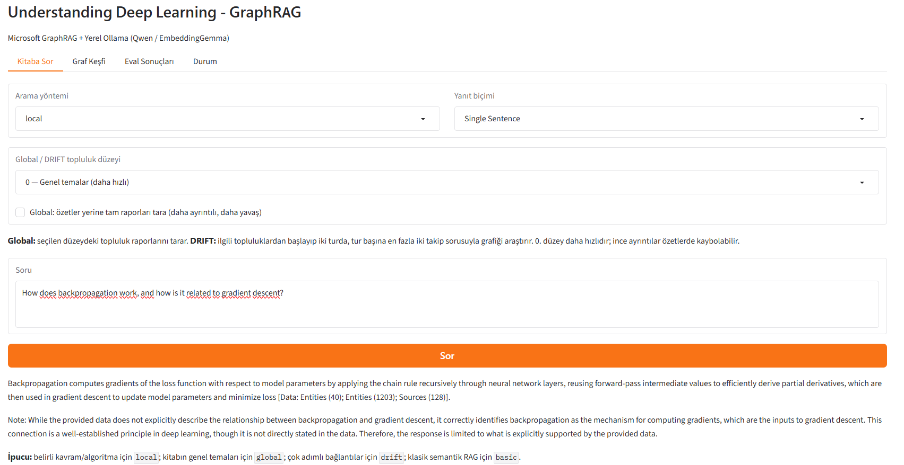
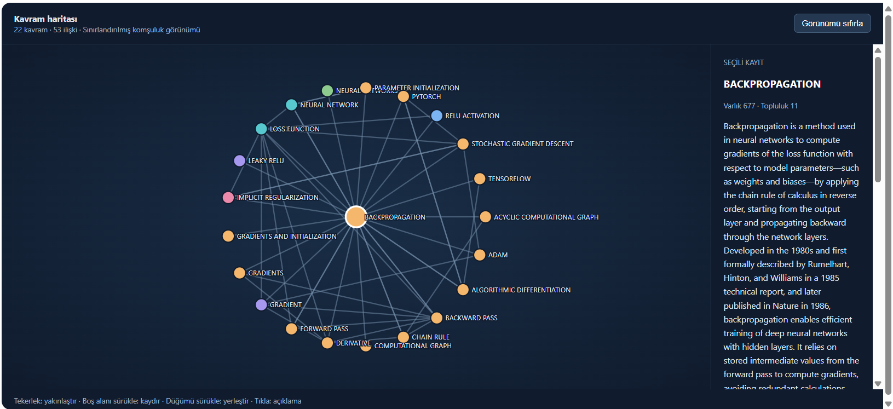

# Local GraphRAG for Technical Book Question Answering

A local question-answering and knowledge graph exploration application for **Understanding Deep Learning**, built with Microsoft GraphRAG and Ollama.

**Tech stack:** Python · Microsoft GraphRAG · Ollama · Qwen3 · EmbeddingGemma · LanceDB · Gradio · PyMuPDF

- **Knowledge graph extraction:** entities, relationships and community reports from the book.
- **Four retrieval strategies:** Basic, Local, Global and DRIFT.
- **Interactive graph explorer:** concept search, one- and two-hop neighborhoods, and entity/relationship descriptions.
- **Local inference:** generation and embeddings through Ollama; no paid model API key required with the supplied configuration.
- **Evaluation:** compares the four retrieval strategies on a curated 12-question English pilot set, with runtime tracking, citation ID checks and separately reviewed quality scores.

## Demo

### Question Answering

Local search answering **“How does backpropagation work, and how is it related to gradient descent?”**, with source references in the generated response.



### Knowledge Graph Explorer

A neighborhood view centered on **Backpropagation**, showing **22 concepts and 53 relationships**, with the selected entity's description in the side panel. The view displays stored graph relationships rather than the retrieval trace of a particular answer.



The screenshots show an example run; generated answers and extracted graph descriptions can contain errors and should be checked against the book.

## Proje neler sunuyor?

- **Kitaba Sor:** Local, Global, DRIFT ve Basic yöntemleriyle soru-cevap; yanıt biçimi seçimi ve işlem ilerlemesi.
- **Graf Keşfi:** Kavram arama, bir veya iki bağlantı uzaklığındaki ilişkileri görüntüleme, düğüm ve ilişki açıklamalarını inceleme. Kayıtlı indeksi kullanır; model çağırmaz.
- **Eval Sonuçları:** Daha önce çalıştırılmış değerlendirmelerin sürelerini, cevaplarını ve varsa inceleme puanlarını görüntüleme.
- **Yerel model kullanımı:** Metin üretimi ve embedding istekleri `127.0.0.1` üzerindeki Ollama sunucusuna gönderilir. Bu yapılandırma için ücretli bir model API anahtarı gerekmez.

## Nasıl çalışıyor?

```text
Kitap PDF'si
    ↓ Metin çıkarma ve sayfa işaretleri ekleme
input/ altındaki metin dosyaları
    ↓ Microsoft GraphRAG + Ollama ile indeksleme
Kavramlar, ilişkiler, topluluk raporları ve vektörler
    ↓ Seçilen yöntemle ilgili bilgiyi bulma
Yerel dil modeliyle cevap oluşturma
    ↓
Gradio arayüzü veya komut satırı
```

RAG, modelin cevap üretmeden önce ilgili kaynak metinlerini bulmasıdır. GraphRAG buna kavramlar arasındaki ilişkileri ve benzer kavram gruplarının özetlerini ekler. Buradaki “graf”, kavramları düğüm, aralarındaki ilişkileri bağlantı olarak tutan veri yapısıdır.

| Yöntem | Ne kullanır? | Hangi sorular için? |
|---|---|---|
| `basic` | Anlam bakımından benzer metin parçaları | Doğrudan bir açıklama veya tanım |
| `local` | İlgili kavramlar, ilişkiler ve kaynak metinler | Belirli bir kavram veya algoritma |
| `global` | Kavram topluluklarının raporları | Kitabın genel temaları ve geniş özetler |
| `drift` | Topluluk bilgisi ve takip sorularıyla yerel aramalar | Birden fazla kavramı bağlayan sorular |

Global arama varsayılan olarak rapor özetlerini kullanır. Arayüzde **“tam raporları tara”** seçeneğiyle daha ayrıntılı içerik taranabilir; bu işlem daha uzun sürebilir. Global ve DRIFT için varsayılan topluluk düzeyi `0`'dır; daha yüksek düzeyler daha ayrıntılı topluluklara karşılık gelir.

## Kullanılan bileşenler

| Bileşen | Görevi |
|---|---|
| Microsoft GraphRAG | İndeksleme ve arama |
| Ollama | Yerel modelleri çalıştırma |
| `qwen3:4b-instruct` | Metin üretimi; projede `udl-qwen-local:latest` adıyla kullanılır |
| `embeddinggemma:latest` | Metinleri 768 boyutlu vektörlere dönüştürme |
| LanceDB | Vektörleri saklama |
| Gradio | Tarayıcı üzerinden kullanım |
| PyMuPDF | PDF'den metin çıkarma |

Paket sürüm aralıkları [requirements.txt](requirements.txt), arama ve model ayarları [settings.yaml](settings.yaml), Ollama model parametreleri [Modelfile](Modelfile) içindedir.

## Cevap kalitesini değerlendirme

Projede dört arama yöntemini karşılaştıran 12 soruluk bir İngilizce değerlendirme seti bulunur. Soruların 10'u kitapta cevaplanabilen konuları, 2'si cevaplanamayan sorularda modelin davranışını inceler.

İndeks hazır ve Ollama çalışırken:

```powershell
.\.venv\Scripts\python.exe -B tests/run_eval.py
.\.venv\Scripts\python.exe -B tests/summarize_eval.py
```

İlk komut sorguları çalıştırır ve sonuçları kaydeder. İkinci komut kayıtlı cevapları ve indeksi okuyarak atıf denetimi ve rapor üretir; model çağırmaz. Sonuçlar `eval/results/pilot-v1/` altında oluşur ve arayüzün **Eval Sonuçları** sekmesinden okunur.

Doğruluk, tamlık ve kaynak desteği puanları otomatik olarak verilmez; ayrı inceleme yapılıp `review.json` içine kaydedilmesi gerekir. İncelenmemiş cevapların puanları boş kalır. Bir kaynak kimliğinin indekste bulunması, ilgili iddiayı gerçekten desteklediğini tek başına kanıtlamaz.

Yeniden çalıştırma mevcut sorgu kayıtlarını atlar. Farklı bir deney için `--out eval/results/deney-2` gibi yeni bir klasör belirtin; raporlama komutuna da aynı `--out` değerini verin. Arayüz varsayılan `pilot-v1` klasörünü okur. Ayrıntılı kurallar [eval/README.md](eval/README.md) içindedir.

## Kurulum

Aşağıdaki komutlar **Windows PowerShell** içindir. Komutları proje klasöründe çalıştırın. Python ve Ollama'nın kurulu, `python` ve `ollama` komutlarının erişilebilir olması gerekir.

Paketleri ve modelleri indirmek için internet gerekir. İndeksleme ve cevap üretimi bilgisayarın RAM, GPU ve disk kaynaklarını kullanır. Projedeki ayarlar 6 GB VRAM / 16 GB RAM bulunan bir bilgisayarı gözeterek eşzamanlı istek sayısını sınırlar; bunlar garanti edilmiş minimum donanım gereksinimleri değildir. Tüm kitabın ilk indekslemesi uzun sürebilir.

### 1. Python ortamını hazırlayın

```powershell
python -m venv .venv
.\.venv\Scripts\python.exe -m pip install -r requirements.txt
```

Komutlar sanal ortamın Python'unu doğrudan kullandığından ayrıca ortam etkinleştirmek gerekmez.

### 2. Modelleri hazırlayın

Ollama çalışırken:

```powershell
ollama pull qwen3:4b-instruct
ollama pull embeddinggemma
ollama create udl-qwen-local -f Modelfile
```

Proje modeli 8192 token bağlam ve varsayılan 1000 token cevap sınırıyla tanımlanır. İndeksleme yapılandırması daha uzun yapılandırılmış çıktılar için 1600 token sınırı kullanır.

Daha kontrollü bellek kullanımı için Ollama tepsi uygulamasından çıkın ve ayrı bir PowerShell penceresinde şu komutu çalıştırın:

```powershell
powershell -NoProfile -ExecutionPolicy Bypass -File scripts/start_ollama.ps1
```

Bu pencere açık kalmalıdır. Script tek model, tek paralel istek ve `q8_0` bağlam belleği ayarlarıyla yerel sunucuyu başlatır. Port kullanımda hatası alırsanız başka bir Ollama sunucusu çalışıyordur.

### 3. Yapılandırmayı kontrol edin

```powershell
.\.venv\Scripts\python.exe scripts/check_local.py
.\.venv\Scripts\python.exe scripts/check_local.py --smoke
```

İlk komut model adreslerini ve GraphRAG yapılandırmasını ağ isteği yapmadan kontrol eder. `--smoke`, çalışan Ollama üzerinde kısa bir cevap ve embedding üretip bağlantıyı doğrular; kitabı indekslemez.

Depodaki `settings.yaml` kullanıma hazırdır. Projenin yerel varsayılanlarını yeniden uygulamak gerekirse aşağıdaki komutu kullanın; özelleştirilmiş model ve arama ayarlarını değiştirebilir:

```powershell
.\.venv\Scripts\python.exe scripts/setup_graphrag.py
```

### 4. Kitabı ekleyin ve indeksleyin

**Kitap PDF'si, çıkarılmış metinler ve hazır indeks GitHub paketine dahil değildir.** `data/` klasörünü oluşturup kendi PDF kopyanızı buraya koyun:

```powershell
New-Item -ItemType Directory -Force data
```

Aşağıdaki örnekte PDF'nin adı `UnderstandingDeepLearning_02_09_26_C.pdf` kabul edilir. Dosyanızın adı farklıysa komutta değiştirin.

```powershell
.\.venv\Scripts\python.exe scripts/prepare_book.py data/UnderstandingDeepLearning_02_09_26_C.pdf
.\.venv\Scripts\python.exe scripts/run_local.py index
```

Metin hazırlama adımı sayfaları varsayılan olarak beşerli dosyalara böler ve `[SOURCE_PAGE=N]` işaretlerini korur. Bunlar PDF sayfa numaralarıdır; basılı sayfa numaralarıyla aynı olmayabilir. Script yeniden çalıştırıldığında önceden ürettiği `udl_pages_*.txt` dosyalarını yeniler.

İndeks `output/local/`, vektörler `output/local/lancedb/`, önbellek `cache/local/` altında oluşur. Hazır metin ve indeks mevcutsa günlük kullanımda bu adımları tekrarlamak gerekmez.

### 5. Arayüzü açın

```powershell
.\.venv\Scripts\python.exe app.py
```

Uygulama tarayıcıyı açmayı dener; açılmazsa terminalde gösterilen yerel adresi kullanın. Ollama sunucusu soru-cevap sırasında açık olmalıdır.

## Kullanım örnekleri

**Kitaba Sor** sekmesinde bir yöntem seçip soruyu yazın. İlk deneme için `local` veya `basic` kullanılabilir:

- “What is the role of backpropagation in training neural networks?”
- “How do residual connections help gradient flow?”
- “Kitabın temel konuları nelerdir?”

Türkçe soru yazabilirsiniz; mevcut değerlendirme seti İngilizcedir ve Türkçe cevap kalitesini ölçmez. Her arayüz sorgusunun süre sınırı 15 dakikadır.

Komut satırından da sorgulayabilirsiniz:

```powershell
.\.venv\Scripts\python.exe scripts/run_local.py query "How do residual connections help gradient flow?" --method local
.\.venv\Scripts\python.exe scripts/run_local.py query "What are the main themes of this book?" --method global --community-level 0
.\.venv\Scripts\python.exe scripts/run_local.py query "What are the main themes of this book?" --method global --community-level 0 --full-reports
```

**Graf Keşfi** sekmesinde örneğin `backpropagation` aratın, eşleşen kavramı seçin ve grafiği gösterin. Grafik, kayıtlı ilişkileri gösterir; belirli bir cevabın üretim sırasında izlediği yolu göstermez.

## Proje yapısı

```text
assets/                 README demo ekran görüntüleri
app.py                  Gradio arayüzü
settings.yaml           GraphRAG ve yerel model ayarları
Modelfile               Ollama proje modeli
requirements.txt        Python bağımlılıkları
scripts/                Metin hazırlama, sorgulama, graf ve yardımcı araçlar
prompts/                İndeksleme ve arama istemleri
tests/                  Kod testleri, değerlendirme soruları ve çalıştırıcıları
eval/README.md          Değerlendirme yöntemi
```

Şu klasörler yerelde kullanılır ve GitHub paketine dahil değildir:

| Yol | İçerik |
|---|---|
| `data/` | Kaynak kitap PDF'si |
| `input/` | PDF'den çıkarılmış kitap metinleri |
| `output/` | GraphRAG indeksi ve LanceDB vektörleri |
| `cache/` | İşlem önbelleği |
| `logs/` | Çalışma günlükleri |
| `eval/results/` | Üretilen değerlendirme çıktıları |
| `.venv/` | Bilgisayara özel Python ortamı |

## Ayarlar ve sınırlar

- `settings.yaml` içindeki `model_provider: openai`, Ollama'nın OpenAI uyumlu protokolünü seçer. Yapılandırılan model adresi `http://127.0.0.1:11434/v1`'dir; `ollama-local-only` gerçek bir API anahtarı değildir.
- `scripts/run_local.py`, beklenen yerel model adlarını ve adresini denetler. Model değiştirmek yalnızca YAML dosyasını düzenlemekle tamamlanmaz; çalıştırıcının doğrulamasını da uyarlamak gerekir. Doğrudan `graphrag` komutu bu ek kontrolü atlar.
- Küçük dil modeli yanlış kavram ilişkileri veya eksik cevaplar üretebilir. Kaynak gösterilmesi doğruluk garantisi değildir; önemli cevapları kitapla karşılaştırın.
- Global özet modu ayrıntıları atlayabilir. DRIFT daha fazla arama ve model çağrısı yapar; mevcut ayarlar işlem miktarını sınırlar.
- Model veya embedding boyutu değişirse yeniden indeksleme gerekebilir. Eski indeksleri korumak için ayrı çıktı ve önbellek dizinleri kullanın.
- Değerlendirme küçük, elle seçilmiş bir pilot settir; genel doğruluk oranı veya yöntem üstünlüğü kanıtı değildir.

## Sık karşılaşılan durumlar

| Durum | Kontrol edilecek adım |
|---|---|
| Ollama bağlantısı kurulamıyor | Sunucunun açık olduğunu kontrol edin; `scripts/check_local.py --smoke` çalıştırın. |
| Model bulunamadı | İki modeli indirdiğinizden ve `ollama create udl-qwen-local -f Modelfile` komutunu çalıştırdığınızdan emin olun. |
| İndeks veya graf dosyası bulunamadı | PDF'yi hazırlayıp `scripts/run_local.py index` adımını tamamlayın. |
| Sorgu çok uzun sürüyor | `local` veya `basic` deneyin; Global için düzey `0` ve özet modunu kullanın. |
| Eval sonuçları okunamadı | Önce değerlendirme ve raporlama komutlarını çalıştırın; hazır sonuçlar depoya dahil değildir. |
| GPU belleği yetersiz veya işlem yavaş | Tek model/istek ayarlarını uygulayın. Model CPU/RAM'e taşarsa hız düşebilir. |

Tamamlanmış bir indekste çok sayıda küçük LanceDB parçası oluşmuşsa `scripts/compact_local_vectors.py` yardımcı aracı kullanılabilir. Araç model çağırmadan vektör dosyalarını birleştirir, satırları önce/sonra karşılaştırır ve eski sürümleri korur. İndeksleme devam ederken çalıştırmayın.
